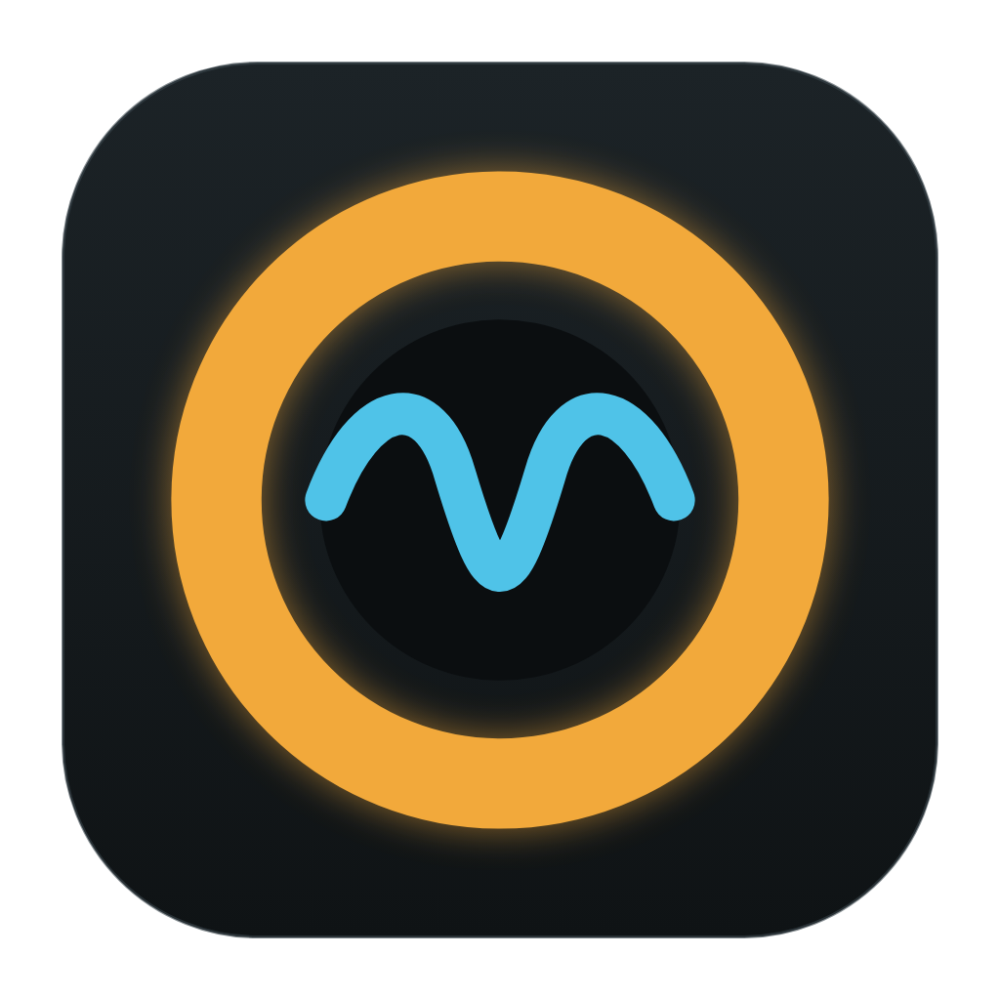
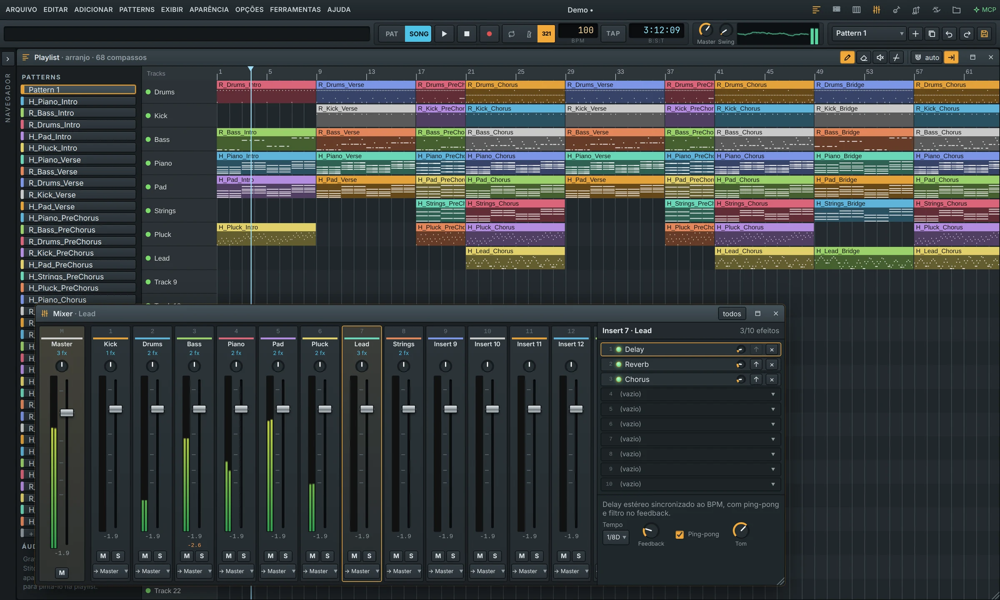
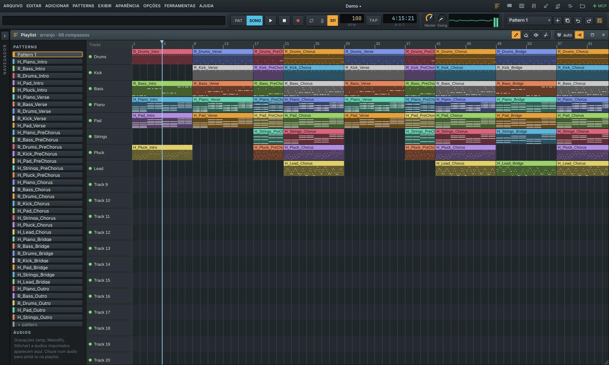
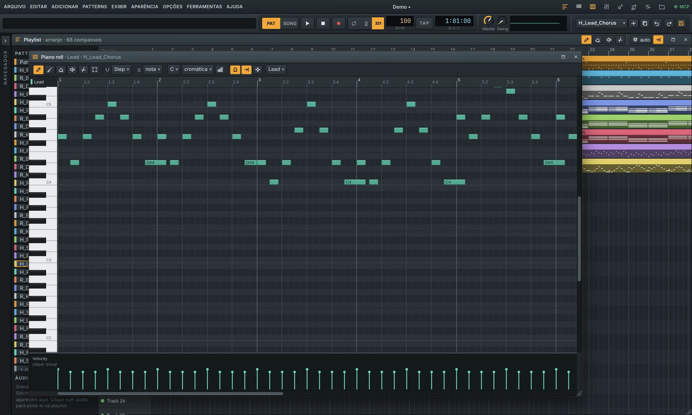
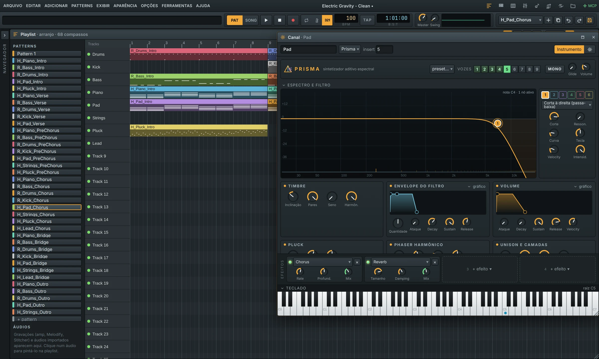
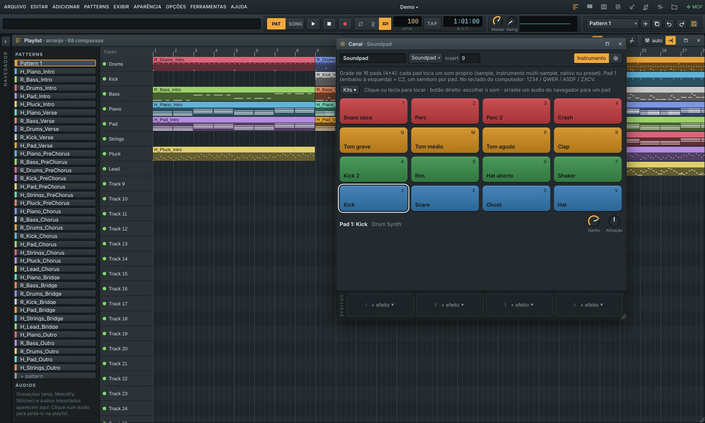
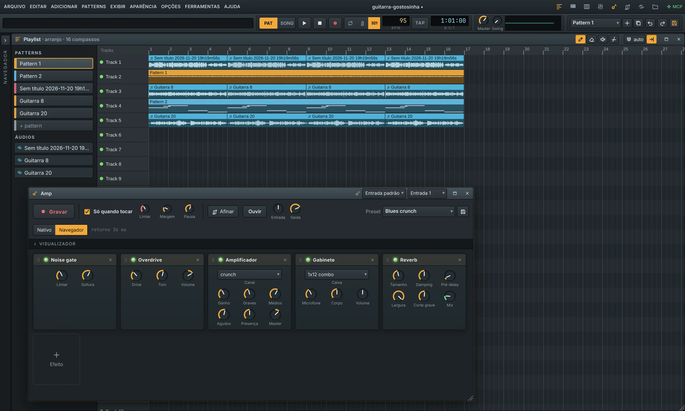
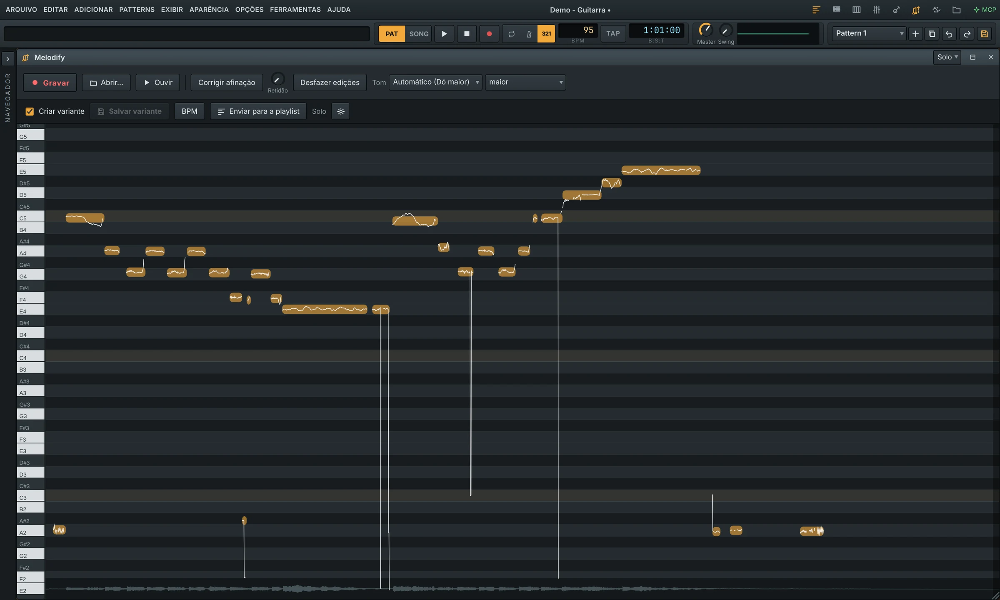

<p align="center">
  
</p>

<h1 align="center">Music Labs</h1>

<p align="center">
  <b>Open source DAW for Linux, Windows and macOS</b><br>
  Channel rack, piano roll, playlist and mixer, an in-house spectral synthesizer and an<br>
  <b>MCP</b> server to make music together with Claude.
</p>

<p align="center">
  <a href="https://github.com/Felpes-Freitas/music-labs/releases/latest"></a>
  <a href="https://github.com/Felpes-Freitas/music-labs/actions/workflows/ci.yml"></a>
  <a href="LICENSE"></a>
  
</p>

<p align="center">
  <a href="README.md">Português</a> · <b>English</b>
</p>

<p align="center">
  <a href="https://github.com/Felpes-Freitas/music-labs/releases/latest"><b>Download</b></a> ·
  <a href="#gallery">Gallery</a> ·
  <a href="#features">Features</a> ·
  <a href="#make-music-with-claude-mcp">MCP</a> ·
  <a href="#run-from-source">Source</a>
</p>

<p align="center">
  
</p>

It is a desktop app (Electron) with the audio engine running in an AudioWorklet. The same
engine runs in Node for offline rendering and mix analysis.

> **Note:** the interface is currently in Brazilian Portuguese. Button names quoted below
> are shown in Portuguese, with a translation.

## Highlights

- **Classic workflow** — channel rack with step sequencer, piano roll, playlist with
  unlimited tracks and a mixer with 16 inserts, routing and sidechain.
- **Built-in instruments** — Prisma (additive spectral synthesizer), subtractive Synth,
  Sampler, Drum Synth, Pluck, FM and a 4×4 Soundpad.
- **Real vocals and guitar** — Amp with a pedal chain and smart recording, **Melodify**
  to tune note by note and **Stitcher** to stitch together the best takes.
- **Make music with Claude** — an MCP server that creates channels, writes notes,
  arranges, mixes and analyzes the result, with every change showing up live in the interface.
- **Nothing is destructive** — every edited audio keeps its original.
- **Opens `.flp` projects** — channels, patterns, notes, playlist and mixer routing.

## Gallery

<table>
  <tr>
    <td width="50%"><br><sub><b>Playlist</b> — full arrangement with patterns colored by instrument.</sub></td>
    <td width="50%"><br><sub><b>Piano roll</b> — notes, velocity, scales and ghost notes.</sub></td>
  </tr>
  <tr>
    <td width="50%"><br><sub><b>Prisma</b> — additive spectral synthesizer with filter, envelopes and channel effects.</sub></td>
    <td width="50%"><br><sub><b>Soundpad</b> — 16 pads played from the computer keyboard.</sub></td>
  </tr>
  <tr>
    <td width="50%"><br><sub><b>Amp</b> — reorderable pedal chain and guitar recordings in the playlist.</sub></td>
    <td width="50%"><br><sub><b>Melodify</b> — every sung or played note becomes an editable block.</sub></td>
  </tr>
</table>

## Install

Download the installer for your system from [Releases](https://github.com/Felpes-Freitas/music-labs/releases):

| System | File | Notes |
| --- | --- | --- |
| Linux | `MusicLabs-<version>-linux-x86_64.AppImage` or `.deb` | The AppImage needs `libfuse2` (`sudo apt install libfuse2`). Make it executable and open it. |
| Windows | `MusicLabs-<version>-win-x64.exe` | The installer is not signed yet: on the SmartScreen warning, click "More info" and "Run anyway". |
| macOS (Apple Silicon) | `MusicLabs-<version>-mac-arm64.dmg` | Unsigned: the first time, right-click the app and choose "Open" (or allow it in Settings > Privacy & Security). |
| macOS (Intel) | `MusicLabs-<version>-mac-x64.dmg` | Same as above. |

ffmpeg is bundled. On first launch Music Labs scans the content folders of installed
DAWs (FL Studio, Ableton Live, Bitwig, LMMS, Splice, GarageBand...; on Linux also inside
Wine) and indexes the samples, which are used where they are.

## Run from source

Requires Node.js 22+.

```bash
git clone https://github.com/Felpes-Freitas/music-labs.git
cd music-labs
npm ci
npm run build
npm run app            # opens the desktop app (the local server starts with it, port 7717)
```

Other commands: `npm test` (tests), `npm run typecheck`, `npm run dev` (interface with
hot reload; run `npm start` in another terminal for the server) and `npm run dist`
(builds the installer for the current system into `release/`).

On Linux, `bin/musiclabs` does the same as `npm run app` and can be linked into
`~/.local/bin`.

### Releases

Installers are built by GitHub Actions (`.github/workflows/release.yml`) when a version
tag is pushed:

```bash
npm version patch      # or minor/major: updates package.json and creates the tag
git push --follow-tags
```

## Features

Click each group to see the details.

<details>
<summary><b>Channel rack, piano roll and playlist</b></summary>

- **Channel rack** with step sequencer (16+ steps, paint by dragging, mute/solo,
  volume/pan, mixer insert) and a mini piano roll for melodic channels. A **this pattern
  only** filter (the eye next to the pattern: shows the channels of the selected pattern and
  new ones that have no notes yet) and, on right-click, **Send to pattern** (moves the
  channel's notes to another pattern).
- **Audio in the rack**: every audio in the project (recording, dropped file, variant) has
  an audio channel with volume, pan, mute, effects and mixer insert (named after the audio).
  That audio's clips play through this channel. A new audio also gets a pattern with its
  name, which works as a group in the rack. Double-clicking an audio clip in the playlist
  opens the channel: waveform, Melodify, Stitcher and settings.
- **Piano roll**: draw, move, resize, delete with right-click, box selection
  (Ctrl+drag), duplicate (Ctrl+D), transpose with the arrow keys, velocity lane, snap
  (including triplets), scale highlighting, ghost notes from other channels, quantize and
  humanize.
- **Playlist**: paint patterns, move, duplicate (Shift+drag), resize (the pattern
  repeats inside the clip), slice, loop region, tracks with mute. Unlimited tracks: the
  playlist always shows more tracks; the project only stores the ones in use.
- **Audio clips**: drag an audio file from the browser into the playlist; the waveform
  shows in the clip, which can be moved, trimmed and sliced and goes to the chosen insert.
- **Selected area**: drag on the ruler (or click a clip) to select a range; it is
  highlighted top to bottom and playback starts there. Right-click inside the area:
  **Fill with** (repeats a pattern, cutting the last one), **Insert instrument**
  (Music Labs instruments, presets, library instruments, Amp, Melodify, Stitcher: creates
  a new pattern with just that instrument filling the area) and delete the clips in it.
- **Automation**: right-click any knob → "Criar clipe de automação" (create automation
  clip). In the clip, click to add points, drag to move them and right-click to delete.
  Works with channel and mixer volume/pan and with instrument and effect parameters.

</details>

<details>
<summary><b>Recording: Amp, Melodify and Stitcher</b></summary>

- **Recording**: the red button records from the microphone/interface from the current
  position, with latency compensation; the waveform shows up in the playlist while
  recording, the file goes to `~/MusicLabs/Gravações` and becomes an audio clip. Input and
  channels (stereo, input 1 or 2 only) in Settings → Audio and recording.
- **Guitar amp** (F10): its own input chosen in the corner of the window (and which
  interface channel), visualizer, an effect chain reordered by dragging (**capo**: shifts
  the input pitch in semitones and, with one click, by octaves, e.g. −1 to play bass with
  a guitar; noise gate, wah, compressor, overdrive, fuzz, amp with clean/crunch/lead
  channels, cabinet, EQ, tremolo, chorus, phaser, delay, reverb), factory and user
  presets, and a Record button that records the processed sound straight into the
  playlist. The dry audio (without the pedals) is kept too: double-clicking an amp
  recording opens the amp on it, and changing the pedals re-renders the recording from the
  dry signal (you can even automate a pedal; the recording then plays the dry signal
  through the pedals in real time). All takes of a recording live in a single rack channel.
  - **Só quando tocar** ("only when playing", smart recording): with the song playing,
    each passage you play becomes a clip where the playhead was; silence is left out.
    Detection learns the background noise (headset hiss, room) and only considers what
    goes above it, with adjustable margin and pause. A **volume threshold** (red line in the
    visualizer) sets the minimum to become a take; short sounds like knocks don't open a
    take, and detection uses a second capture with the browser's echo cancellation so the
    music coming out of the speakers isn't mistaken for you playing. This "denoise" is only
    used to decide the cuts: it does not change the monitoring or the recorded audio. Also
    works with loop.
  - Monitoring runs in a separate audio context with a minimal buffer and a light chain;
    the recording keeps the raw signal and reapplies the effects in high quality (amp,
    overdrive and fuzz oversampled 4x) when each take closes.
- **Audio list** (next to the playlist, with the patterns; adjustable width): recordings
  and audio from Melodify and Stitcher live here. Drag them into the playlist;
  double-click opens them in Melodify. The original file of each audio is never deleted.
- **Melodify** (F11): everything happens inside it. Record (the song doesn't play and the
  waveform shows up live), open a file, pick an audio from the list or drag a clip from
  the playlist. Each note shows up as a block at the sung pitch: drag it to another pitch
  (key grid; Ctrl: any semitone; Shift: free), double-click to tune, "Corrigir afinação"
  (fix tuning) moves everything to the nearest note in the key and "Retidão" (straightness)
  flattens the wobble. The key is detected and can be changed. With **Criar variante**
  (create variant) checked, applying creates a new audio in the list; unchecked, it changes
  the audio itself (the original is kept and can be restored). **Enviar para a playlist**
  (send to playlist) puts the audio in the song (variants right below the original). Space
  plays Melodify's audio when it has focus. The **BPM** button detects the tempo of the
  audio (e.g. a guitar recording of yours) and offers to set the project to that BPM, with
  the audio aligned to the grid.
- **Stitcher** (F12): at the top, the waveform of the result, with each piece in the color
  of the audio it came from (click to play from there; Space when the window has focus);
  right below, the melody; at the bottom, the audios, each in its color with the pieces
  used highlighted. Record inside it (each recording shows up live in the list and joins
  the stitch), add from the computer or the project, or drag files and clips. The audios
  are aligned with each other; Stitcher detects the key, infers the intended note of each
  passage and uses the audio that got closest to it. Drag a melody note to correct it;
  with "Afinar na melodia" (tune to melody) the result is tuned to those notes. "Salvar na
  lista" (save to list) and "Enviar para a playlist" (send to playlist) keep the result.
  Manual control: drag the boundaries of the result to change the cuts; right-click a piece
  to use another audio, split, merge or **open just that piece in Melodify** — whatever is
  applied there comes back into the stitch (and can be disabled), without touching the
  original take. The Stitcher session (audios, key, cuts, choices and edited pieces) is
  saved in the project and comes back when reopened; undo also covers changes made in it.
- **Nothing is destructive**: every audio in the list keeps its original; edits can be
  disabled and re-enabled ("ed." badge in the list, button in Melodify).
- **Global REC**: records **notes** (computer keyboard, MIDI keyboard, on-screen piano)
  and **automation**: any knob you move (drag, wheel, double-click, middle button) becomes
  automation for that parameter from that moment on (before that it stays as it was). The
  knob turns red with "● AUTO" while recording; knobs that already have automation get a
  dot. With loop on, each pass becomes a new pattern on another track. Vocals and audio
  instruments are handled by Amp, Melodify and Stitcher.

</details>

<details>
<summary><b>Mixer, instruments and effects</b></summary>

- **Mixer**: 16 inserts + master, fader, pan, mute/solo, meters, routing between inserts
  (buses), up to 10 effects per insert with dry/wet.
- **Built-in instruments**: Prisma (additive spectral synthesizer: alias-free harmonic
  filter, pluck, spectral phaser, 8-voice unison, octave layers, draggable envelopes,
  ensemble), subtractive Synth (2 osc + sub, unison up to 7, filter with envelope, LFO,
  glide/mono), Sampler (files or multi-sample instruments from folders, hold/release with
  sustain loop, root detected by pitch, choke groups), Drum Synth (kick, 808, snare, clap,
  hats, tom, rim, perc, and a "kit" mode with GM map), Pluck (Karplus-Strong) and FM.
- **Effects**: 4-band EQ + HPF, filter with synced LFO, compressor with **sidechain**,
  synced delay (ping-pong), reverb, chorus, saturation, bitcrusher, stereo imager (mono
  below X Hz) and limiter.
- **Soundpad**: 16 colored pads (4×4), each with any sound you want (sample,
  multi-sample instrument, built-in instrument or preset); on the computer keyboard,
  1234 / QWER / ASDF / ZXCV in the same layout as the screen. Ready-made kits
  (synthesized, work without samples).

</details>

<details>
<summary><b>Interface, transport and navigation</b></summary>

- **Transport**: **loop** (on the selected area or the whole song), **metronome** and
  **count-in** (3, 2, 1 before recording).
- **Hints**: the top bar explains what is under the mouse; in Settings → Appearance you
  can switch to tooltips near the mouse (then the top controls are centered).
- **Tap tempo**: the TAP button next to the BPM. Click along with the song and the BPM
  follows your clicks.
- **Side browser**, collapsible (button at the top or Alt+F8).
- Sample browser (installed FL packs, ~/Música, Downloads, ~/MusicLabs/Samples) with
  search, preview and drag to the rack.
- **Settings** (Appearance menu or Ctrl+,): Graphite, OLED and Adobe themes, accent color
  with a color picker, Alt + drag windows, recording input and shortcuts.
- **Stop twice** also cuts reverb/echo tails and hanging notes.
- Computer keyboard as a piano (Z…/ and Q…], with the symbols `, . ; /` and `[ = ]` on
  the right; Page Down/Page Up change the octave), MIDI keyboard (Web MIDI), unlimited
  undo/redo, autosave, WAV export at 16/24/32-bit.

</details>

<details>
<summary><b>Import and integrations</b></summary>

- **Imports FL Studio .flp**: channels, patterns, notes, playlist, mixer names and
  channel→insert routing. Samples are resolved from the Wine installation; FL plugins
  become the closest built-in instrument (FPC → kit, bass → reese, pad → pad...).
- **RGB keyboard** (optional, via [OpenRGB](https://openrgb.org)): the keys follow the
  selected instrument — the keyboard "piano" in black and white, or the Soundpad pad
  colors — and the key you play lights up. Works with the keyboards OpenRGB controls
  (SteelSeries, Corsair, Razer, Logitech, HyperX…). On first launch, if an RGB peripheral
  is plugged in, Music Labs offers to download the official OpenRGB (verified by SHA-256;
  Linux and Windows x64) and runs it by itself, with no window, only while the app is open;
  if you already use OpenRGB with the SDK server on, nothing is downloaded. Settings → RGB
  lighting. When Music Labs closes, the keyboard goes back to its previous lighting.

</details>

Shortcuts: Space play/stop · L pattern/song · F5 playlist · F6 rack · F7 piano roll ·
F8 browser · F9 mixer · Ctrl+S save · Ctrl+Z/Y undo/redo.

## Make music with Claude (MCP)

The MCP server talks to the open app (port 7717) and starts the server by itself if the
app is closed. It lives in the repository: after `npm ci && npm run build`,

```bash
claude mcp add -s user musiclabs -- node /path/to/music-labs/build/mcp.mjs
```

It works both with the installed app and when running from source. Every edit shows up
in the interface right away, with a "Claude · …" notice. Tools:

| group | tools |
| --- | --- |
| reading | `get_project`, `get_notes`, `list_sounds`, `search_samples`, `sample_library`, `music_theory` |
| project | `new_project`, `set_project`, `save_project`, `open_project` (.mlstudio and .flp), `list_projects`, `undo`, `redo` |
| channels | `add_channel`, `update_channel` (includes root note and fine tuning), `remove_channel` |
| notes | `add_pattern`, `edit_pattern`, `set_steps`, `add_notes`, `add_chords`, `clear_notes`, `transform_notes` |
| arrangement | `arrange`, `update_track` |
| mixer and effects | `mixer_insert`, `add_effect`, `update_effect`, `remove_effect` (on an insert or directly on a channel) |
| batch | `batch` (several atomic actions = one undo) |
| audio | `transport`, `preview_notes`, `render`, `analyze_mix` (LUFS, peak, crest, correlation, bands, level per insert) |

## Where data lives

- Projects and renders: `~/MusicLabs` (`Projetos/`, `Renders/`, `Samples/`).
- State (autosave, library index): `~/.local/share/musiclabs` on Linux,
  `%APPDATA%\MusicLabs` on Windows, `~/Library/Application Support/MusicLabs` on macOS.

## Architecture

```
src/core     model, ops (synced editing + undo), actions, theory, DSP,
             instruments, effects, engine, analysis, WAV, .flp importer
src/server   HTTP + WebSocket (127.0.0.1), project state, samples (ffmpeg), render
src/mcp      MCP server (stdio) that talks to the HTTP server
src/web      Preact interface + AudioWorklet with the engine
```

## License

GPL-3.0-or-later (see `LICENSE`). The installers include ffmpeg (GPL), via
[ffmpeg-static](https://github.com/eugeneware/ffmpeg-static).

## About FL Studio

Music Labs is an original project. No code, binary, plugin, artwork or trademark of
Image-Line was copied or decompiled. `.flp` compatibility was built from project files
(data) created by a legitimate installation and from public documentation of the format,
for interoperability only. FL sample packs are only read locally from your installation;
nothing is redistributed.

## Current limitations

- No VST/LV2/CLAP plugin hosting (next step: a bridge via Carla/yabridge).
- Automation is linear between points (no curves) and only plays in song mode.
- FL plugins are approximated by built-in instruments on import; FL mixer effects are not
  imported.
