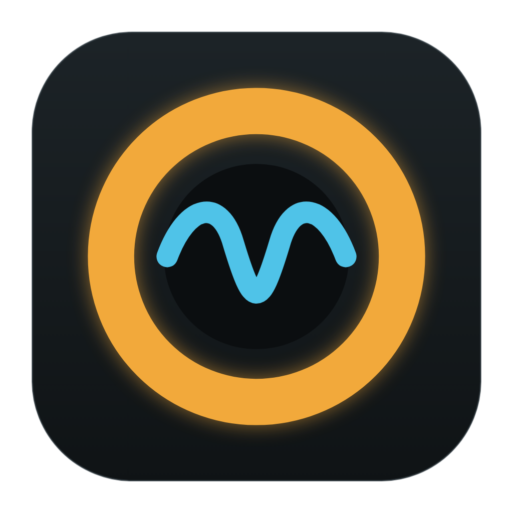
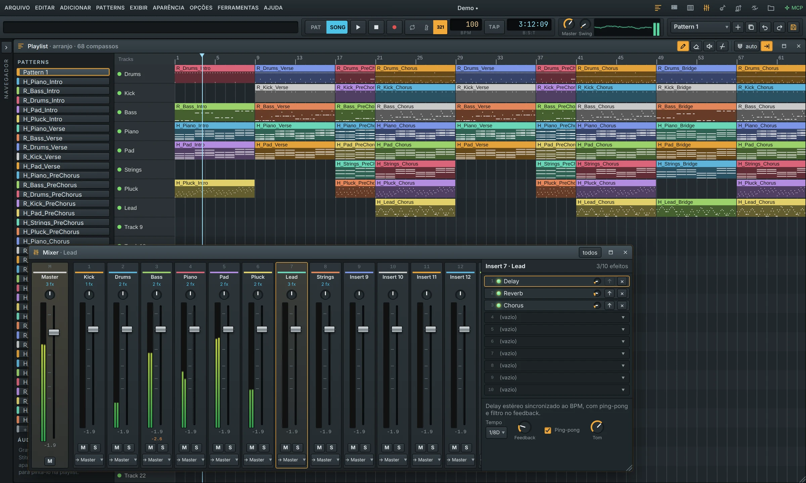
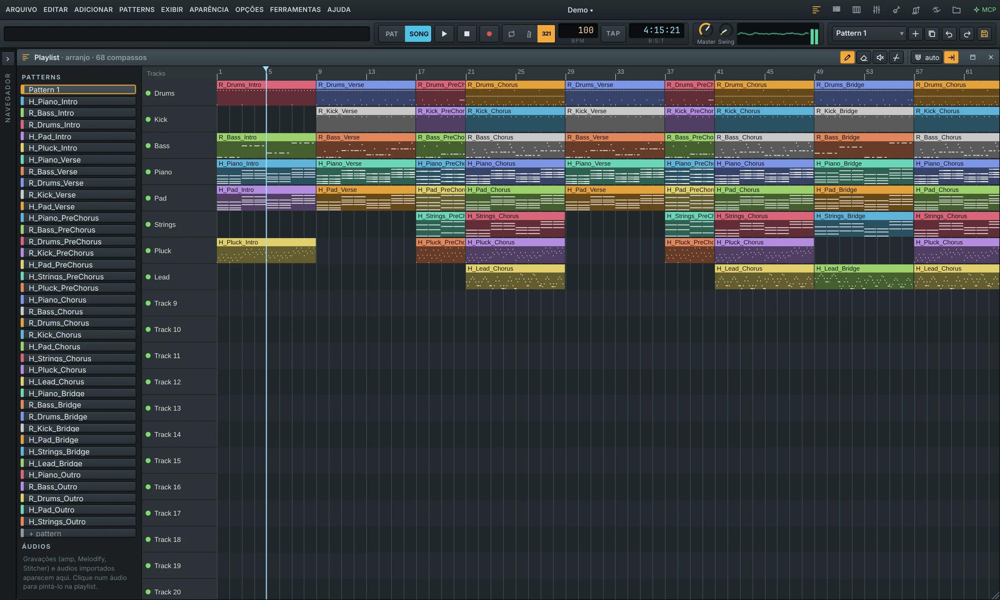
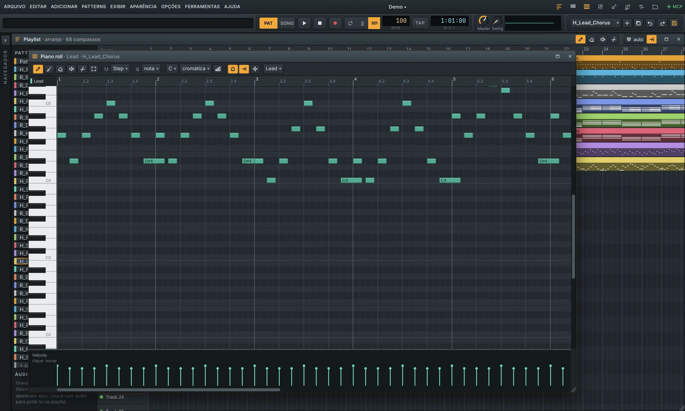
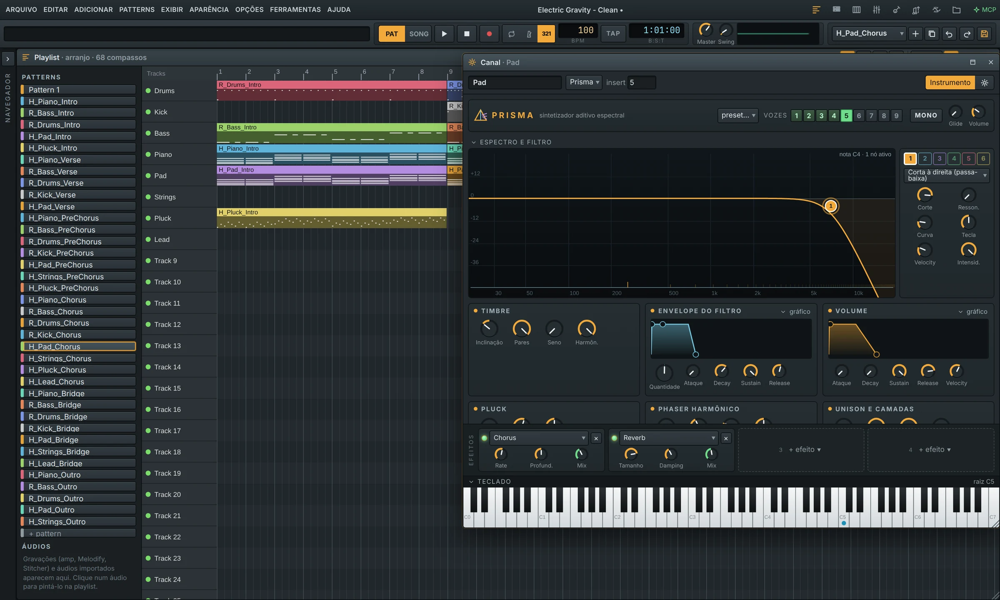
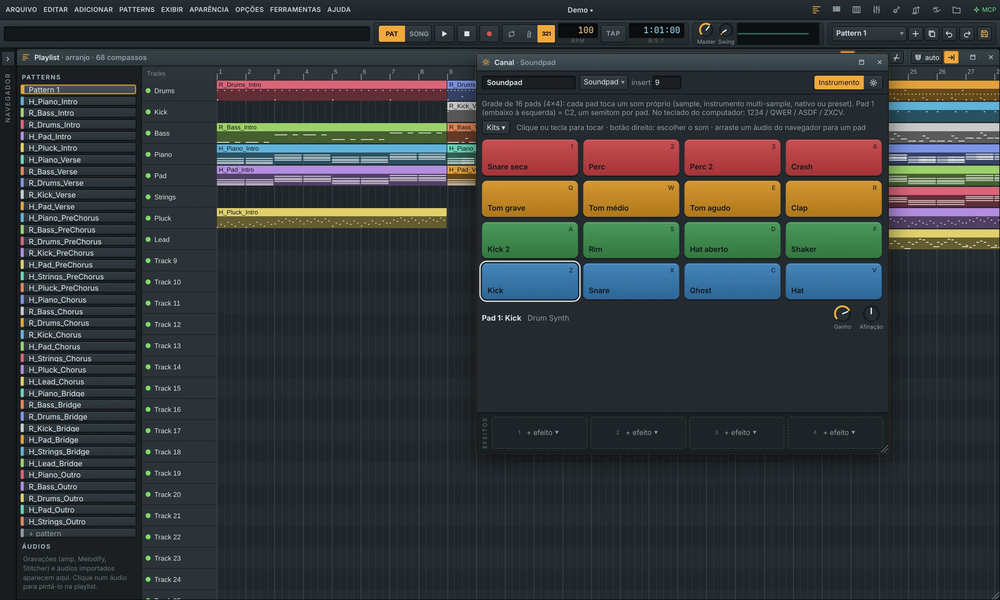
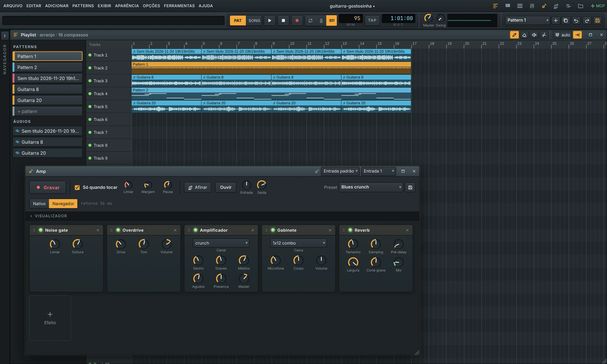
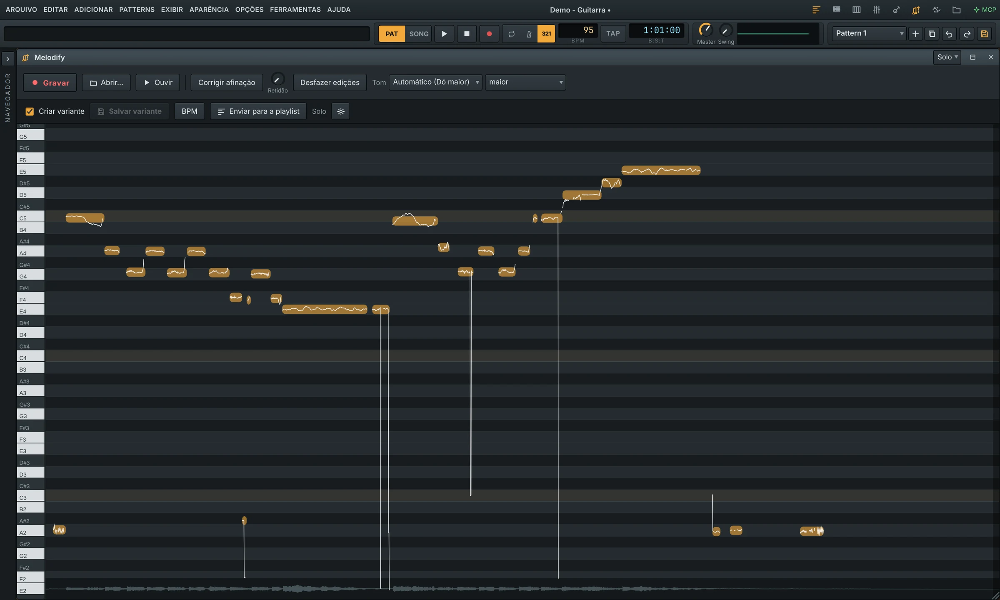

<p align="center">
  
</p>

<h1 align="center">Music Labs</h1>

<p align="center">
  <b>DAW open source para Linux, Windows e macOS</b><br>
  Rack de canais, piano roll, playlist e mixer, um sintetizador espectral próprio e um<br>
  servidor <b>MCP</b> para produzir música junto com o Claude.
</p>

<p align="center">
  <a href="https://github.com/Felpes-Freitas/music-labs/releases/latest"></a>
  <a href="https://github.com/Felpes-Freitas/music-labs/actions/workflows/ci.yml"></a>
  <a href="LICENSE"></a>
  
</p>

<p align="center">
  <a href="https://github.com/Felpes-Freitas/music-labs/releases/latest"><b>Baixar</b></a> ·
  <a href="#galeria">Galeria</a> ·
  <a href="#recursos">Recursos</a> ·
  <a href="#produzir-com-o-claude-mcp">MCP</a> ·
  <a href="#rodar-a-partir-do-código">Código</a>
</p>

<p align="center">
  
</p>

É um app desktop (Electron) com a engine de áudio rodando num AudioWorklet. A mesma
engine roda no Node para render offline e análise de mix.

## Destaques

- **Fluxo de trabalho clássico** — rack de canais com step sequencer, piano roll, playlist
  com tracks infinitas e mixer com 16 inserts, roteamento e sidechain.
- **Instrumentos próprios** — Prisma (sintetizador aditivo espectral), Synth subtrativo,
  Sampler, Drum Synth, Pluck, FM e um Soundpad 4×4.
- **Voz e guitarra de verdade** — Amp com cadeia de pedais e gravação inteligente,
  **Melodify** para afinar nota por nota e **Stitcher** para costurar os melhores takes.
- **Produza com o Claude** — um servidor MCP que cria canais, escreve notas, arranja,
  mixa e analisa o resultado, com tudo aparecendo ao vivo na interface.
- **Nada é destrutivo** — todo áudio editado guarda o original.
- **Abre projetos `.flp`** — canais, patterns, notas, playlist e roteamento do mixer.

## Galeria

<table>
  <tr>
    <td width="50%"><br><sub><b>Playlist</b> — arranjo completo com patterns coloridos por instrumento.</sub></td>
    <td width="50%"><br><sub><b>Piano roll</b> — notas, velocity, escalas e ghost notes.</sub></td>
  </tr>
  <tr>
    <td width="50%"><br><sub><b>Prisma</b> — sintetizador aditivo espectral com filtro, envelopes e efeitos no canal.</sub></td>
    <td width="50%"><br><sub><b>Soundpad</b> — 16 pads tocados pelo teclado do computador.</sub></td>
  </tr>
  <tr>
    <td width="50%"><br><sub><b>Amp</b> — cadeia de pedais reordenável e gravações de guitarra na playlist.</sub></td>
    <td width="50%"><br><sub><b>Melodify</b> — cada nota cantada ou tocada vira um bloco editável.</sub></td>
  </tr>
</table>

## Instalar

Baixe o instalador do seu sistema em [Releases](https://github.com/Felpes-Freitas/music-labs/releases):

| Sistema | Arquivo | Observação |
| --- | --- | --- |
| Linux | `MusicLabs-<versão>-linux-x86_64.AppImage` ou `.deb` | O AppImage precisa do `libfuse2` (`sudo apt install libfuse2`). Dê permissão de execução e abra. |
| Windows | `MusicLabs-<versão>-win-x64.exe` | O instalador ainda não é assinado: no aviso do SmartScreen, clique em "Mais informações" e "Executar assim mesmo". |
| macOS (Apple Silicon) | `MusicLabs-<versão>-mac-arm64.dmg` | Sem assinatura: na primeira vez, clique com o botão direito no app e escolha "Abrir" (ou libere em Ajustes > Privacidade e Segurança). |
| macOS (Intel) | `MusicLabs-<versão>-mac-x64.dmg` | Mesmo procedimento acima. |

O ffmpeg vem embutido. Na primeira abertura o Music Labs varre as pastas de conteúdo
das DAWs instaladas (FL Studio, Ableton Live, Bitwig, LMMS, Splice, GarageBand...;
no Linux também dentro do Wine) e indexa os samples, que são usados no lugar onde
estão.

## Rodar a partir do código

Requer Node.js 22+.

```bash
git clone https://github.com/Felpes-Freitas/music-labs.git
cd music-labs
npm ci
npm run build
npm run app            # abre o app desktop (o servidor local sobe junto, porta 7717)
```

Outros comandos: `npm test` (testes), `npm run typecheck`, `npm run dev` (interface com
recarga automática; rode `npm start` em outro terminal para o servidor) e
`npm run dist` (gera o instalador do sistema atual em `release/`).

No Linux, `bin/musiclabs` faz o mesmo que `npm run app` e pode ser ligado em
`~/.local/bin`.

### Releases

Os instaladores são gerados pelo GitHub Actions (`.github/workflows/release.yml`) ao
enviar uma tag de versão:

```bash
npm version patch      # ou minor/major: atualiza package.json e cria a tag
git push --follow-tags
```

## Recursos

Clique em cada grupo para ver os detalhes.

<details>
<summary><b>Rack, piano roll e playlist</b></summary>

- **Rack de canais** com step sequencer (16+ steps, pintar arrastando, mute/solo,
  volume/pan, insert do mixer) e mini piano roll para canais melódicos. Filtro **só este
  pattern** (o olho ao lado do pattern: mostra os canais do pattern selecionado e os novos, ainda sem notas) e, no
  botão direito, **Enviar para pattern** (move as notas do canal para outro pattern).
- **Áudios no rack**, como no FL Studio: cada áudio do projeto (gravação, arquivo
  arrastado, variante) tem um canal de áudio com volume, pan, mute, efeitos e insert do
  mixer (com o nome do áudio). Os clipes desse áudio tocam por esse canal. Um áudio novo
  ganha também um pattern com o nome dele, que serve de grupo no rack. Duplo clique num
  áudio da playlist abre o canal: a onda, Melodify, Stitcher e as configurações.
- **Piano roll**: desenhar, mover, redimensionar, apagar com o botão direito, seleção
  por retângulo (Ctrl+arrastar), duplicar (Ctrl+D), transpor com as setas, faixa de
  velocity, snap (inclusive tercinas), destaque de escala, ghost notes dos outros
  canais, quantizar e humanizar.
- **Playlist**: pintar patterns, mover, duplicar (Shift+arrastar), redimensionar (o
  pattern repete dentro do clip), fatiar, região de loop, tracks com mute. Tracks
  infinitas: a playlist sempre mostra mais tracks; o projeto só guarda as usadas.
- **Clips de áudio**: arraste um áudio do navegador para a playlist; a forma de onda
  aparece no clip, que pode ser movido, cortado e fatiado e vai para o insert escolhido.
- **Área selecionada**: arraste na régua (ou clique num clipe) para selecionar um trecho;
  ele fica destacado de cima a baixo e o play começa nele. Botão direito dentro da área:
  **Preencher com** (repete um pattern, cortando o último), **Inserir instrumento**
  (Music Labs, presets, instrumentos da biblioteca/FL, Amp, Melodify, Stitcher: cria um
  pattern novo só com ele ocupando a área) e apagar clipes da área.
- **Automação**: botão direito em qualquer knob → "Criar clipe de automação". No clip,
  clique para criar pontos, arraste para mover e use o botão direito para apagar.
  Funciona com volume/pan de canais e do mixer e com parâmetros de instrumentos e efeitos.

</details>

<details>
<summary><b>Gravação: Amp, Melodify e Stitcher</b></summary>

- **Gravação**: o botão vermelho grava do microfone/interface a partir da posição
  atual, com compensação de latência; a onda aparece na playlist enquanto grava, o
  arquivo vai para `~/MusicLabs/Gravações` e vira um clip de áudio. Entrada e canais
  (estéreo, só entrada 1 ou 2) em Configurações → Áudio e gravação.
- **Amp de guitarra** (F10): entrada própria escolhida no canto da janela (e qual
  canal da interface), visualizador, cadeia de efeitos reordenável arrastando
  (**capotraste**: muda o tom da entrada em semitons e, com um clique, de oitava, por
  exemplo −1 para tocar baixo com a guitarra; noise gate, wah, compressor, overdrive, fuzz, amplificador com canais clean/crunch/lead,
  gabinete, EQ, tremolo, chorus, phaser, delay, reverb), presets de fábrica e seus, e
  botão Gravar que grava o som já com os efeitos direto na playlist. O áudio bruto (sem
  os pedais) também fica guardado: duplo clique numa gravação do amp abre o amp nela,
  e mudar os pedais refaz a gravação a partir do bruto (dá até para automatizar um pedal;
  aí a gravação toca o bruto pelos pedais em tempo real). Todos os takes de uma gravação
  ficam num canal só no rack.
  - **Só quando tocar** (gravação inteligente): com a música tocando, cada trecho que
    você toca vira um clipe onde o ponteiro estava; o silêncio fica de fora. A detecção
    aprende o ruído de fundo (chiado de headset, ambiente) e só considera o que passa
    acima dele, com margem e pausa ajustáveis. Um **limiar de volume** (linha vermelha no
    visualizador) define o mínimo para virar gravação; sons curtos como batidas não abrem
    take, e a detecção usa uma segunda captura com cancelamento de eco do navegador, para
    não confundir a música saindo dos alto-falantes com você tocando. Esse "denoise" serve só para decidir os
    cortes: não altera o retorno nem o áudio gravado. Funciona também com loop.
  - O retorno roda num contexto de áudio separado, com buffer mínimo e a cadeia leve; a
    gravação guarda o sinal cru e reaplica os efeitos em alta qualidade (amp, overdrive e
    fuzz sobreamostrados 4x) ao fechar cada take.
- **Lista de áudios** (ao lado da playlist, junto dos patterns; largura ajustável): as
  gravações e os áudios do Melodify e do Stitcher ficam aqui. Arraste para a playlist,
  duplo clique abre no Melodify. O arquivo original de cada áudio nunca é apagado.
- **Melodify** (F11): tudo acontece dentro dele. Grave (a música não toca e a onda
  aparece ao vivo), abra um arquivo, escolha um áudio da lista ou arraste um clipe da
  playlist. Cada nota aparece como um bloco na altura cantada: arraste para outra altura
  (grade do tom; Ctrl: qualquer semitom; Shift: livre), duplo clique afina, "Corrigir
  afinação" leva tudo à nota do tom mais próxima e "Retidão" endireita a oscilação. O
  tom é detectado e pode ser trocado. Com **Criar variante** marcado, aplicar cria um
  áudio novo na lista; desmarcado, altera o próprio áudio (o original fica guardado e
  pode ser restaurado). **Enviar para a playlist** coloca o áudio na música (variantes
  logo abaixo do original). Espaço toca o áudio do Melodify quando ele está em foco.
  O botão **BPM** detecta o andamento do áudio (ex.: uma gravação sua de guitarra) e
  oferece colocar o projeto nesse BPM, com o áudio alinhado à grade.
- **Stitcher** (F12): em cima, a onda do resultado, com cada pedaço na cor do áudio de
  onde veio (clique para tocar dali; Espaço com a janela em foco); logo abaixo, a
  melodia; embaixo, os áudios, cada um com a sua cor e os pedaços usados destacados.
  Grave dentro dele (cada gravação aparece ao vivo na lista e entra na costura), adicione
  do computador ou do projeto, ou arraste arquivos e clipes. Os áudios são alinhados entre
  si; o Stitcher detecta o tom, deduz a nota pretendida de cada trecho e usa o áudio que
  chegou mais perto dela. Arraste uma nota da melodia para corrigir; com "Afinar na
  melodia" o resultado sai afinado nessas notas. "Salvar na lista" e "Enviar para a
  playlist" guardam o resultado. Controle manual: arraste as divisas do resultado para
  mudar os cortes; botão direito num pedaço para usar outro áudio, dividir, juntar ou
  **abrir só aquele pedaço no Melodify** — o que for aplicado lá volta para a costura
  (e pode ser desativado), sem mexer no take original. A sessão do Stitcher (áudios,
  tom, cortes, escolhas e pedaços editados) é salva no projeto e volta ao reabrir; desfazer
  também vale para as mudanças feitas nele.
- **Nada é destrutivo**: todo áudio da lista guarda o original; as edições podem ser
  desativadas e reativadas (selo "ed." na lista, botão no Melodify).
- **REC geral**: grava **notas** (teclado do computador, teclado MIDI, piano na tela) e
  **automações**: qualquer knob mexido (arrastar, roda, duplo clique, botão do meio) vira
  automação daquele parâmetro a partir daquele momento (antes disso ele fica como estava).
  O knob fica vermelho com "● AUTO" enquanto grava; knobs que já têm automação ganham um
  ponto. Com o loop, cada volta vira um pattern
  novo numa outra track. Voz e instrumentos de áudio ficam com o Amp, o Melodify e o
  Stitcher.

</details>

<details>
<summary><b>Mixer, instrumentos e efeitos</b></summary>

- **Mixer**: 16 inserts + master, fader, pan, mute/solo, medidores, roteamento entre
  inserts (buses), até 10 efeitos por insert com dry/wet.
- **Instrumentos nativos**: Prisma (sintetizador aditivo espectral: filtro harmônico
  sem aliasing, pluck, phaser no espectro, unison de 8 vozes, camadas de oitava,
  envelopes arrastáveis, ensemble), Synth subtrativo (2 osc + sub, unison até 7, filtro com
  envelope, LFO, glide/mono), Sampler (arquivos ou instrumentos multi-sample de pastas,
  segura/solta com loop de sustentação, raiz detectada por afinação, grupos de corte), Drum Synth (kick, 808, snare, clap, hats, tom, rim,
  perc, e modo "kit" com mapa GM), Pluck (Karplus-Strong) e FM.
- **Efeitos**: EQ 4 bandas + HPF, filtro com LFO sincronizado, compressor com
  **sidechain**, delay sincronizado (ping-pong), reverb, chorus, saturação, bitcrusher,
  imagem estéreo (mono abaixo de X Hz) e limiter.
- **Soundpad**: 16 pads (4×4) coloridos, cada um com o som que você quiser (sample,
  instrumento multi-sample, nativo ou preset); no teclado do computador, 1234 / QWER /
  ASDF / ZXCV na mesma disposição da tela. Kits prontos (sintetizados, funcionam sem samples).

</details>

<details>
<summary><b>Interface, transporte e navegação</b></summary>

- **Transporte**: **loop** (na área selecionada, ou na música inteira), **metrônomo** e
  **contagem** (3, 2, 1 antes de gravar).
- **Dicas**: a barra do topo explica o que está sob o mouse; em Configurações → Aparência
  dá para trocar por balões perto do mouse (aí os controles do topo ficam centralizados).
- **Tap tempo**: o botão TAP ao lado do BPM. Clique no ritmo da música e o BPM segue
  os cliques.
- **Navegador lateral** recolhível (botão no topo ou Alt+F8).
- Navegador de samples (packs do FL instalados, ~/Música, Downloads, ~/MusicLabs/Samples)
  com busca, pré-escuta e arrastar para o rack.
- **Configurações** (menu Aparência ou Ctrl+,): temas Grafite, OLED e Adobe, cor de
  destaque com seletor de cor, Alt + arrastar janelas, entrada de gravação e atalhos.
- **Parar duas vezes** corta também as caudas de reverb/eco e notas soltas.
- Teclado do computador como piano (Z…/ e Q…], com os símbolos `, . ; /` e `[ = ]` à direita; Page Down/Page Up mudam a oitava), teclado MIDI
  (Web MIDI), undo/redo ilimitado, autosave, exportação WAV 16/24/32-bit.

</details>

<details>
<summary><b>Importação e integrações</b></summary>

- **Importa .flp do FL Studio**: canais, patterns, notas, playlist, nomes do mixer e
  roteamento canal→insert. Samples são resolvidos na instalação do Wine; plugins do FL
  viram o instrumento nativo mais próximo (FPC → kit, baixo → reese, pad → pad...).
- **Teclado RGB** (opcional, via [OpenRGB](https://openrgb.org)): as teclas acompanham o
  instrumento selecionado — o "piano" do teclado em branco e preto, ou as cores dos pads do
  Soundpad — e a tecla tocada acende. Funciona com os teclados que o OpenRGB controla
  (SteelSeries, Corsair, Razer, Logitech, HyperX…). Na primeira abertura, se houver um
  periférico RGB plugado, o Music Labs oferece baixar o OpenRGB oficial (conferido pelo
  SHA-256; Linux e Windows x64) e o roda sozinho, sem janela, só enquanto o app está aberto;
  quem já usa o OpenRGB com o servidor SDK ligado não baixa nada. Configurações → Iluminação
  RGB. Ao fechar o Music Labs, o teclado volta à iluminação que tinha.

</details>

Atalhos: Espaço tocar/parar · L pattern/song · F5 playlist · F6 rack · F7 piano roll ·
F8 navegador · F9 mixer · Ctrl+S salvar · Ctrl+Z/Y desfazer/refazer.

## Produzir com o Claude (MCP)

O servidor MCP conversa com o app aberto (porta 7717) e sobe o servidor sozinho se o
app estiver fechado. Ele fica no repositório: depois de `npm ci && npm run build`,

```bash
claude mcp add -s user musiclabs -- node /caminho/para/music-labs/build/mcp.mjs
```

Funciona tanto com o app instalado quanto rodando a partir do código. Toda edição
aparece na hora na interface, com aviso "Claude · …". Ferramentas:

| grupo | ferramentas |
| --- | --- |
| leitura | `get_project`, `get_notes`, `list_sounds`, `search_samples`, `sample_library`, `music_theory` |
| projeto | `new_project`, `set_project`, `save_project`, `open_project` (.mlstudio e .flp), `list_projects`, `undo`, `redo` |
| canais | `add_channel`, `update_channel` (inclui nota raiz e ajuste fino), `remove_channel` |
| notas | `add_pattern`, `edit_pattern`, `set_steps`, `add_notes`, `add_chords`, `clear_notes`, `transform_notes` |
| arranjo | `arrange`, `update_track` |
| mixer e efeitos | `mixer_insert`, `add_effect`, `update_effect`, `remove_effect` (num insert ou direto num canal) |
| lote | `batch` (várias ações atômicas = um undo) |
| áudio | `transport`, `preview_notes`, `render`, `analyze_mix` (LUFS, pico, crest, correlação, bandas, nível por insert) |

## Onde ficam os dados

- Projetos e renders: `~/MusicLabs` (`Projetos/`, `Renders/`, `Samples/`).
- Estado (autosave, índice da biblioteca): `~/.local/share/musiclabs` no Linux,
  `%APPDATA%\MusicLabs` no Windows, `~/Library/Application Support/MusicLabs` no macOS.

## Arquitetura

```
src/core     modelo, ops (edição sincronizada + undo), ações, teoria, DSP,
             instrumentos, efeitos, engine, análise, WAV, importador .flp
src/server   HTTP + WebSocket (127.0.0.1), estado do projeto, samples (ffmpeg), render
src/mcp      servidor MCP (stdio) que fala com o servidor HTTP
src/web      interface Preact + AudioWorklet com a engine
```

## Licença

GPL-3.0-or-later (veja `LICENSE`). Os instaladores incluem o ffmpeg (GPL), via
[ffmpeg-static](https://github.com/eugeneware/ffmpeg-static).

## Sobre o FL Studio

O Music Labs é um projeto original. Nenhum código, binário, plugin, arte ou marca da
Image-Line foi copiado ou decompilado. A compatibilidade com `.flp` foi feita a partir
dos arquivos de projeto (dados) gerados por uma instalação legítima e da documentação
pública do formato, apenas para interoperabilidade. Os packs de samples do FL só são
lidos localmente da sua instalação; nada é redistribuído.

## Limitações atuais

- Sem hospedagem de plugins VST/LV2/CLAP (próximo passo: ponte via Carla/yabridge).
- Automação é linear entre pontos (sem curvas) e só toca no modo song.
- Plugins do FL no import são aproximados por instrumentos nativos; efeitos do mixer
  do FL não são importados.
